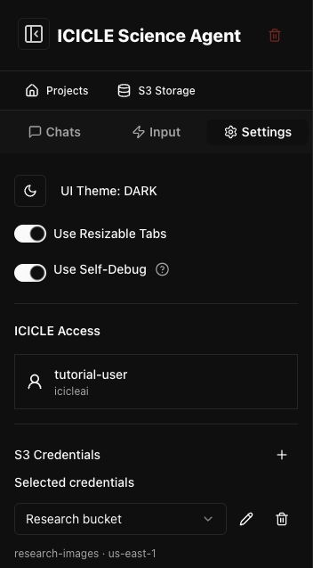
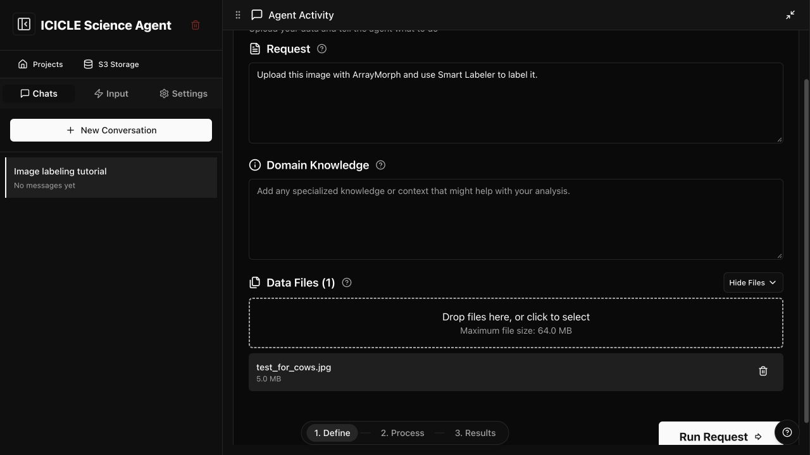
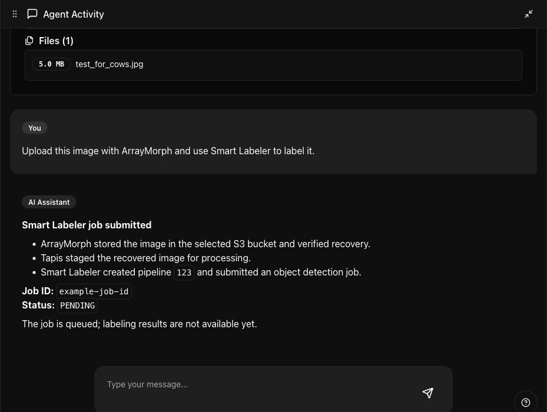

# Science Agent Frontend

Science Agent helps researchers use ICICLE services and resources through natural-language requests. This frontend provides the browser interface for uploading data, managing conversations, and following work performed by the remote Science Agent, including ArrayMorph storage and Smart Labeler workflows.

**Tags:** Software, CI4AI

### License

[](LICENSE)

This project continues the MIT license of the original
[ScienceAgentInterface](https://github.com/ICICLE-ai/ScienceAgentInterface), retaining its copyright notice.

## References

- [Science Agent Backend](https://github.com/ICICLE-ai/science-agent-backend)
- [ICICLE](https://icicle.osu.edu/)
- [Smart Labeler](https://github.com/ICICLE-ai/smart_labeler)
- [ArrayMorph](https://github.com/ICICLE-ai/ArrayMorph)

## Acknowledgements

*National Science Foundation (NSF) funded AI institute for Intelligent Cyberinfrastructure with Computational Learning in the Environment (ICICLE) (OAC 2112606)*

---

# Tutorials

## Store files and request labeling

This walkthrough uses a image, a valid ICICLE account, a working backend and agent pod, and an S3 bucket you can access. Smart Labeler submission also requires access to the configured Tapis storage and compute resources.

The screenshots below use example account, bucket, and job information.

### 1. Select an S3 profile

Open Science Agent from the ICICLE hub. The backend identifies your account from the Tapis cookie. In the sidebar, open **Settings**. Under **S3 Credentials**, use **Add S3 credentials** to enter your endpoint, bucket, region, access key, and secret key or import a supported credential file. Save the profile, then choose it under **Selected credentials**. Do not paste credentials into chat.



### 2. Attach files and run the request

Open **Chats** and select **New Conversation**. Upload files under **Data Files**. In the **Request** field, enter the prompt below and click **Run Request**.

> Upload this image with ArrayMorph and use Smart Labeler to label it.



### 3. Read the job report

When the request succeeds, the report describes the ArrayMorph storage and recovery, Tapis staging, Smart Labeler pipeline creation, and job submission. Note the pipeline ID and job ID.



A status such as `PENDING` means the job was submitted, not that the labels are ready. To check progress, follow up in the same conversation using the actual job ID from your report:

> Check the status of job JOB_ID. Do not submit another job.

If a step fails, check the last reported stage before retrying. An earlier step may already have saved data or created a pipeline.

## Ask for advice or continue previous work

For advice without starting a job, ask:

> Suggest a model strategy for animal images. Explain the recommendation, but do not create a pipeline or submit a job.

For storage only, ask:

> Store this uploaded image with ArrayMorph in my selected S3 bucket.

Reopen a conversation from the conversation list or Gallery to review its messages and continue the work. Deleting a conversation removes its application records, not jobs or objects already created in external services.

---

# How-To Guides

## Configure and start

Set the frontend's `.env`:

```env
VITE_API_BASE_URL=https://YOUR_BACKEND_HOST
```

Use the browser-accessible backend origin without `/api`. For local development, set it empty to use Vite's existing proxy to port 8000. If output files are served separately, set `VITE_STATIC_FILE_BASE_URL` to their base URL. Never put credentials in `VITE_*` variables.

Run using Docker Compose:

```sh
docker compose up -d
```

Compose downloads Node, installs dependencies, builds the frontend, and serves it at `http://localhost:3000`. It does not require a project Dockerfile or a prebuilt project image. Restart after changing frontend environment settings.

For local development instead:

```sh
npm ci
npm run dev
```

The development address is `http://localhost:5173`. When hub cookies are unavailable locally, put `DEV_TAPIS_TOKEN=<your user token>` in the private `.env.development` file. This development-only setting is not used by the production Compose server.

---

# Explanation

## A service-oriented research assistant

The user describes a goal rather than writing API calls or managing a command-line agent. Science Agent connects that request with available ICICLE services. The frontend is the interaction layer; it does not run the agent, hold database credentials, or submit HPC jobs directly.

The backend validates the user, retrieves the conversation and files, and sends request-specific context to a remote agent pod. The agent uses the supplied service instructions and the user's credentials to perform the requested work. Conversations and uploaded files are stored in PostgreSQL.

## Current scope

The integrated labeling workflow currently accepts exactly one image. Model recommendations are advice, not proof that a particular model is deployed or that an image has been analyzed. External service access and job completion must be checked independently.

The S3 Storage page remains visible, but its browsing and deletion API has not been migrated to the current FastAPI backend. Use the conversation workflow for supported storage operations. Older code-execution controls also do not imply support for the original coding-agent workflow.

Production hub integration must make the Tapis cookie available to the backend and support authenticated HTTP and WebSocket requests. Compose alone does not configure this integration or HTTPS.
